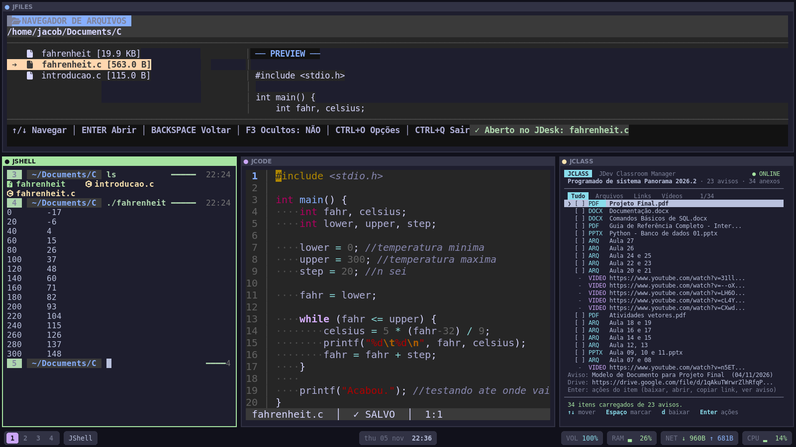
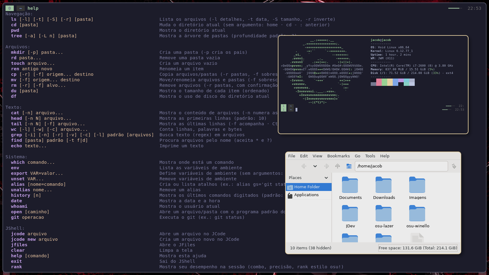
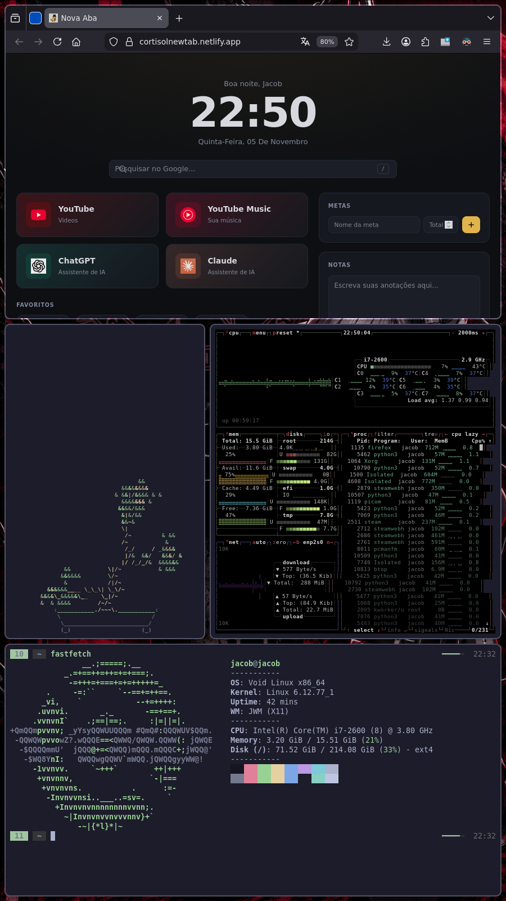

# JDev

Um ambiente gráfico **leve, bonito e feito à mão** para Linux/X11, em Python: gerenciador de janelas
em mosaico, desktop com terminais, editor, shell e gerenciador de arquivos, tudo com uma paleta única.

Grátis, aberto e independente (licença MIT). Testado no **Void Linux**.



| Só o JWM (`--no-ui`) | Monitor em pé |
|---|---|
|  |  |

## O que tem aqui

| Programa | Função |
|---|---|
| **JWM** | Gerenciador de janelas X11 com mosaico em árvore (estilo Sway), janelas flutuantes, 4 workspaces e multi-monitor |
| **JDesk** | Desktop com painéis (JFiles, JShell, JCode, JClass) e a barra |
| **JBar** | Barra em pílulas no rodapé: workspaces, relógio, volume, RAM, rede, CPU e o estado do JWM |
| **JTerm** | Emulador de terminal em Tk (usado pelos painéis do JDesk e como terminal avulso) |
| **JCode** | Editor de código no terminal, com realce de sintaxe |
| **JShell** | Shell interativo com prompt em pílulas, realce e sugestões |
| **JFiles** | Gerenciador de arquivos no terminal, com prévia |
| **JRun** | Executor de comandos (`Super+D`) |
| **jtheme** | Temas: Tokyo Night, Catppuccin Mocha, Gruvbox Dark e Dawn (claro) |

Bibliotecas internas: `jtile.py` (mosaico), `jipc.py` (mensagens entre os programas), `jicons.py` (ícones).
Ferramentas opcionais ficam em `tools/` (JClass, JSlides, JPlayer...).

## Instalação

### 1. Dependências do sistema (nomes do Void; em outras distros procure os equivalentes)

```bash
sudo xbps-install -S xorg-minimal xinit python3 python3-tkinter python3-xlib xrandr git
```

Opcionais, mas recomendados:

```bash
sudo xbps-install -S picom xwallpaper xsetroot   # sombras e cantos arredondados, wallpaper, cursor
```

### 2. Baixar e instalar as dependências Python

```bash
git clone https://github.com/jacob-derek/JDev.git ~/JDev
cd ~/JDev
pip install --user -r requirements.txt
```

Precisa de Python 3.10 ou mais novo. Se o seu sistema reclamar de `externally-managed-environment`,
use um ambiente virtual com acesso aos pacotes do sistema:
`python3 -m venv --system-site-packages ~/.venvs/jdev && . ~/.venvs/jdev/bin/activate`.

Ferramentas opcionais (`tools/`): `pip install --user -r requirements-tools.txt`.
O `pymupdf` é AGPL e é instalado por você; o JDev não o inclui.

### 3. Iniciar

De um TTY (fora do X):

```bash
~/JDev/start-jwm            # ambiente completo: JWM + JDesk + JBar
~/JDev/start-jwm --no-ui    # só o gerenciador de janelas, sem JDesk e sem JBar
```

Para ter o comando `jwm`:

```bash
mkdir -p ~/.local/bin
ln -s ~/JDev/start-jwm ~/.local/bin/jwm
```

Para sair: `Super+Shift+Q`.

## Atalhos

`Super` é a tecla do Windows. Os atalhos seguem o espírito do Sway.

### JWM (janelas)

| Atalho | Ação |
|---|---|
| `Super+Enter` | Abrir terminal |
| `Super+D` | Abrir o JRun (executar comando) |
| `Super+E` | Abrir o gerenciador de arquivos |
| `Super+Q` | Fechar a janela ativa |
| `Super+Shift+Q` | Sair do JWM |
| `Super+H/J/K/L` ou setas | Mover o foco |
| `Super+Shift+H/J/K/L` ou setas | Trocar a janela de lugar com a vizinha (flutuante: redimensiona) |
| `Super+Ctrl+setas` | Redimensionar pela divisória |
| `Super+R` | Modo resize: `H/L` largura, `J/K` altura, `Enter`/`Esc` sai |
| `Super+B` / `Super+V` | A próxima janela divide lado a lado / empilhada |
| `Super+T` | Alternar a divisão (horizontal ↔ vertical) |
| `Super+F` | Tela cheia |
| `Super+Espaço` | Alternar flutuante / mosaico |
| `Super+Tab` | Próxima janela |
| `Super+1..4` | Ir para o workspace |
| `Super+Shift+1..4` | Mandar a janela para o workspace |
| `Super+Shift+B` | Mostrar / esconder a barra |
| `Super+setas` (flutuante) | Mover a janela |
| `Super+arrastar` (botão 1) | Mover a janela (vira flutuante) |
| `Super+arrastar` (botão 3) | Redimensionar a janela (vira flutuante) |

### JDesk (painéis)

O JDesk usa `Alt` no lugar do `Super`:

| Atalho | Ação |
|---|---|
| `Alt+H/J/K/L` ou setas | Mover o foco entre painéis |
| `Alt+Shift+H/J/K/L` | Trocar o painel de lugar |
| `Alt+1..4` | Workspace do JDesk (ou clique na barra) |
| `Alt+F` ou `Alt+Z` | Tela cheia do painel |
| `Alt+R` | Modo resize dos painéis |
| `Alt+Shift+Q` / `Alt+Shift+R` | Matar / reiniciar o programa do painel |
| `Alt+Shift+E` | Fechar o JDesk (pede confirmação) |
| `Alt+=` / `Alt+-` / `Alt+M` | Volume + / − / mudo |

Dentro de cada painel valem os atalhos do JTerm (`Ctrl+Shift+C/V`, `Shift+PgUp`, `Ctrl+roda` para o zoom).

## Configuração

### Temas

```bash
python3 jtheme.py              # lista os temas (o ativo vem marcado)
python3 jtheme.py show         # mostra as cores no terminal
python3 jtheme.py set gruvbox  # grava a escolha em ~/.config/jdev/theme
```

Vale na próxima sessão. Para testar só uma vez: `JTHEME=dawn python3 JShell.py`.
O `jtheme.py` é opcional: sem ele ao lado, cada programa usa o Tokyo Night embutido.

### Wallpaper

Coloque as imagens em `~/.config/jdev/`:

- `horizontal.png` (ou `.jpg`/`.jpeg`/`.webp`): monitores deitados
- `vertical.png`: monitores em pé

O `jwm-layout` escolhe pela orientação real de cada monitor e ajusta a imagem ao tamanho dele
(precisa do `xwallpaper`; `feh` e `hsetroot` funcionam como plano B). `JWM_WALLPAPER=/caminho/img`
usa a mesma imagem em todos. O JDesk cobre o monitor primário, então o wallpaper aparece nos demais.

### Monitores

O padrão assume HDMI à esquerda (primário) e VGA à direita, em pé. Ajuste sem editar arquivos:

```bash
JWM_VGA_MODE=1366x768 JWM_VGA_RATE=60 JWM_VGA_ROTATE=normal ~/JDev/start-jwm
```

Com um só monitor, o `jwm-layout` simplesmente o usa.

### Cursor

O "X" feio do Xorg some com um tema de cursor. Instale um (por exemplo Adwaita ou Bibata) e, no
`jwm-session`, exporte `XCURSOR_THEME` e `XCURSOR_SIZE` e rode `xsetroot -cursor_name left_ptr`.

### Efeitos (picom)

Sombras, cantos arredondados e animações vêm do picom, que é opcional (animações pedem a v12 ou mais nova).
Um ponto de partida para o `~/.config/picom/picom.conf`:

```conf
backend = "glx";
vsync = true;
unredir-if-possible = true;
corner-radius = 10;
shadow = true;
shadow-radius = 14;
shadow-opacity = 0.35;
animations = (
  { triggers = ["open", "show"];  preset = "appear";          duration = 0.18; scale = 0.92; },
  { triggers = ["close", "hide"]; preset = "disappear";       duration = 0.14; scale = 0.92; },
  { triggers = ["geometry"];      preset = "geometry-change"; duration = 0.18; }
);
```

Sem blur de propósito: é o efeito mais caro e o JDev quer ser leve.

## Arquivos que o JDev usa

| Caminho | Para quê |
|---|---|
| `~/.config/jdev/theme` | Tema escolhido |
| `~/.config/jdev/horizontal.*`, `vertical.*` | Wallpapers |
| `~/.cache/jwm.log` | Log do gerenciador de janelas |
| `~/.cache/jwm-session.log` | Log da sessão, dos monitores e do wallpaper |
| `~/.cache/jwm-state.json` | Estado do JWM para a JBar (modo, divisão, título, barra visível) |

## Desenvolvimento

```bash
python3 -m unittest discover -s tests -t . -v   # testes (só biblioteca padrão)
scripts/xephyr-test.sh                          # JWM numa janela, sem arriscar a sessão
scripts/xephyr-test.sh --no-ui                  # idem, só o gerenciador de janelas
```

O GitHub Actions roda os testes em cada push.

## Solução de problemas

- **Tela preta ao iniciar:** `Ctrl+Alt+F2` volta ao TTY. Veja `tail ~/.cache/jwm.log ~/.cache/jwm-session.log`.
- **Wallpaper não aparece:** confira se o `xwallpaper` está instalado e o `~/.cache/jwm-session.log`.
- **Sem barra:** `Super+Shift+B` alterna a barra; sem o JDesk (`--no-ui`) não há barra.
- **Cores diferentes entre programas:** confira `python3 jtheme.py` e se `JTHEME` está definida no ambiente.

## Licença

[MIT](LICENSE).
