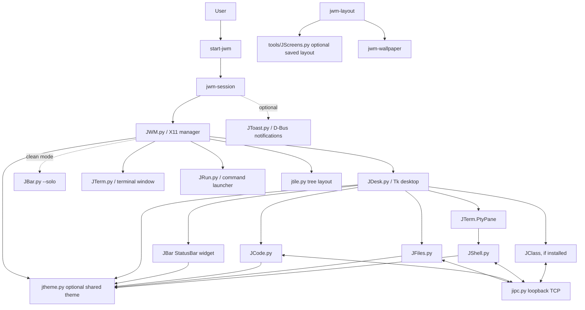

# JDev architecture

This chapter synthesizes the completed source-based architecture study. It gives the system boundaries and execution path; deeper lifecycle, protocol, configuration, and component mechanics are linked to focused chapters. Statements describe the inspected checkout, with optional paths marked as conditional.

## System context

The diagram shows relationships established by direct imports or explicit launch/message calls. Dotted edges are conditional. The [desktop runtime stack](INTEGRATION/DESKTOP_RUNTIME_STACK.md) and [shared infrastructure](INTEGRATION/SHARED_INFRASTRUCTURE.md) define IPC routing and ownership in detail.

## Startup and lifecycle (observed)

1. `start-jwm` resolves its own directory, checks for `startx` and Python Xlib, chooses the first available X socket number from `:0` through `:9`, then `exec`s `startx` with `jwm-session` (`start-jwm:1-31`).
2. `jwm-session` re-enters under `dbus-run-session` if it has no D-Bus session, logs setup, configures cursor, runs `jwm-layout`, conditionally starts picom and JToast, and finally replaces itself with Python running `JWM.py` (`jwm-session:1-51`).
3. JWM imports `Arvore`/`vizinho` from `jtile.py`; normal mode launches JDesk (which hosts JBar), clean/no-JDesk mode launches standalone JBar, and bare mode launches neither. JWM also handles terminal/JRun launch paths (`JWM.py:36-38`, `:231-260`, `:1049-1079`, `:1485-1501`). See the [JWM and tiling deep dive](COMPONENTS/JWM_AND_TILING.md) for shutdown and the `--no-ui` help mismatch.
4. In the integrated desktop path, JDesk imports JBar’s metrics/status/volume helpers and JTerm’s embedded PTY components (`JDesk.py:44-46`). It starts a JIPC server before its workspaces (`JDesk.py:300-308`) and resolves JFiles, JShell, JCode, and optional JClass command paths (`JDesk.py:83-108`).

## Architectural layers and boundaries

| Layer | Main pieces | Role / evidence |
|---|---|---|
| Session and OS integration | `start-jwm`, `jwm-session`, `jwm-layout`, `jwm-wallpaper`, `jfiles-picker` | Start X, initialize services/layout, set wallpaper, expose file chooser bridge. |
| Window manager | `JWM.py`, `jtile.py` | Xlib window management plus a separate tree layout structure. |
| Desktop composition | `JDesk.py`, `JTerm.py`, `JBar.py`, `jpopup.py` | Tk desktop panes, embedded PTYs, status bar/popups. |
| User applications | `JCode.py`, `JShell.py`, `JFiles.py`, `JRun.py`, `JAnalyzer.py`, `JToast.py` | Editor, interactive shell, file manager, launcher, repository analyzer, notification service. |
| Shared infrastructure | `jipc.py`, `jtheme.py`, `jstatus.py`, `jicons.py`, `jlog.py`, `jfcore.py`, `jrcore.py`, `jwall.py` | Cross-program messaging, visual consistency, shared logic, logs, wallpaper-derived theme support. |
| Optional tools | `tools/` and `chessyou/` | Additional integrations/apps with distinct dependencies and lifecycles. |

## Communication and state ownership

- **Direct Python imports:** shared code such as `jfcore`, `jrcore`, `jtile`, `jstatus`, and `jtheme` is imported by consumers.
- **Local IPC:** `jipc.py` defines an authenticated loopback TCP message mechanism. JDesk starts a server; JFiles, JCode, JShell, and JClass conditionally send requests. Detailed routing and acknowledgement behavior are documented in the shared-infrastructure and desktop-runtime chapters.
- **Environment and process arguments:** `start-jwm`, `jwm-session`, JWM, JTerm, and the monitor scripts pass flags/environment variables and spawn subprocesses.
- **Filesystem state:** user configuration/cache locations hold theme choice, monitor layout, logs, launcher cache/usage, JFiles recents, notification state, and runtime snapshots. The exact paths, precedence, writers, and readers are mapped in [configuration and state](INTEGRATION/CONFIGURATION_AND_STATE.md).
- **X11 and D-Bus:** JWM talks to X11; JToast conditionally integrates with D-Bus. `jwm-layout` delegates physical display configuration to xrandr/JScreens.

## Dependency boundaries, operation, and limits

The README and manifests describe core dependencies and optional packages in `requirements.txt` and `requirements-tools.txt`. Tkinter and Xorg utilities are system dependencies; Python-Xlib and pyte anchor the WM and terminal; prompt_toolkit/Pygments support terminal UIs. The repository also contains platform-conditional Windows dependencies. Component chapters trace actual imports and fallback behavior; the [build and validation chapter](INTEGRATION/BUILD_AND_VALIDATION.md) records declared dependencies and CI limits.

The architecture is mostly a co-located set of scripts/modules rather than one installed package: imports rely on nearby files and tools sometimes add the repository root to `sys.path`. `chessyou/` is a separately packaged Python project with its own tests and dependencies (`chessyou/pyproject.toml`, `requirements.txt`). The integration is intentionally lightweight: direct imports share code within a process, JIPC carries selected session requests across processes, and files/environment variables carry configuration or snapshots. These contracts do not provide a single service supervisor or package-wide lifecycle manager.

## Detailed architecture chapters

- [JWM and tiling](COMPONENTS/JWM_AND_TILING.md) — X11 event ownership, window/workspace model, geometry, shortcuts, process handling, shutdown.
- [Desktop runtime stack](INTEGRATION/DESKTOP_RUNTIME_STACK.md) — JDesk/JTerm/JBar process and thread boundaries, JIPC request/response behavior.
- [Session integration](INTEGRATION/SESSION_AND_DESKTOP_INTEGRATION.md) — X startup, D-Bus, display layout, wallpaper, portal chooser.
- [Configuration and state](INTEGRATION/CONFIGURATION_AND_STATE.md) — XDG paths, precedence, durable state, caches, and snapshots.
- [Shared infrastructure](INTEGRATION/SHARED_INFRASTRUCTURE.md) — shared imports and cross-process contracts.
- [Integrated workflows](INTEGRATION/WORKFLOWS.md) — end-to-end data and control paths.

The static architecture investigation is complete. Runtime-dependent questions—such as PTY cleanup on forced session termination and behavior under real hotplug—are recorded as validation limits in [Progress](PROGRESS.md) and are not represented as verified behavior here.
