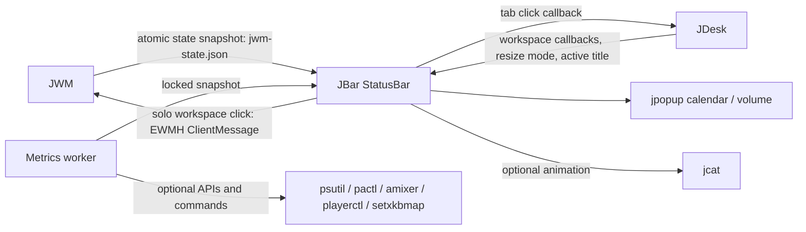

# JBar — status bar, live metrics, and desktop controls

JBar is the session’s compact control surface. In the integrated desktop, `StatusBar` is embedded in JDesk; in JWM’s clean/no-UI path, JBar can run as its own override-redirect dock window. The distinction matters: the integrated instance gets workspace changes from JDesk callbacks, while solo mode reads JWM’s state file and asks JWM to switch desktops through EWMH. The module describes these modes at [JBar.py:13-18](../../JBar.py#L13) and implements the standalone entry at [JBar.py:805-866](../../JBar.py#L805).

## Identity and boundaries

JBar’s job is presentation and lightweight controls: workspace tabs, current WM/JDesk modes, title, clock, volume, keyboard layout, CPU/RAM, and optional player metadata. It does not own workspace state or window layout. In normal JDesk use, `set_workspaces` is a UI update API and `on_select` delegates selection back to JDesk; the bar is not a second window manager ([JBar.py:418-433](../../JBar.py#L418), [JBar.py:473-480](../../JBar.py#L473)).

The important integration paths are:

Facts: JBar imports `CalendarioPopup` and `VolumePopup` unconditionally from lowercase `jpopup`, while `jtheme` and `jcat` are optional imports with local fallback behavior ([JBar.py:33-56](../../JBar.py#L33)). It reads `jwm-state.json` using `XDG_CACHE_HOME` or `~/.cache` ([JBar.py:393-395](../../JBar.py#L393)). Inference: the popup import is a hard startup dependency even though the theme and cat decoration are optional.

## Execution and lifecycle

There are two launch routes. Running `python JBar.py` creates a small test window and a `Metrics` instance ([JBar.py:867-878](../../JBar.py#L867)). The `--solo` branch creates a borderless top-level window with dock type, starts metrics, constructs `StatusBar`, and runs Tk’s event loop ([JBar.py:805-859](../../JBar.py#L805)). In the desktop session, JDesk constructs the widget in its own root and owns the root event loop and shutdown; see [JDesk.py](JDESK.md) for that lifecycle.

`StatusBar.start()` starts three Tk `after` loops: visual refresh, state polling, and optional cat animation. `stop()` cancels those scheduled callbacks ([JBar.py:482-497](../../JBar.py#L482)). The metrics worker threads have a distinct lifetime: caller starts `Metrics`, and `stop()` signals its `Event` ([JBar.py:259-339](../../JBar.py#L259)). Standalone `sair()` stops both and destroys the root; a watcher checks the supplied WM PID every two seconds and exits when the WM is gone ([JBar.py:847-859](../../JBar.py#L847)).

## Metrics: background collection and safe UI handoff

`Metrics.data` is a small dictionary protected by a `threading.Lock`; `snapshot()` returns a shallow copy under that lock ([JBar.py:259-282](../../JBar.py#L259)). `_run_loop()` imports optional `psutil`, establishes baselines, waits 0.8 seconds for an initial CPU/network sample, then samples every 1.5 seconds ([JBar.py:283-339]). Network rates are byte-counter deltas divided by elapsed monotonic time. CPU’s first `psutil.cpu_percent(None)` call is intentionally only a baseline. If psutil is absent, CPU/RAM/network stay unavailable while clock and supported audio controls still work.

The UI’s 250ms `refresh()` callback only reads a snapshot and renders; it does not run shell commands ([JBar.py:792-799](../../JBar.py#L792)). This is a sensible separation: slow process/COM calls cannot directly block Tk’s event loop. It also means collection cadence and paint cadence differ: the UI can repaint immediately after clicks or state changes, while telemetry updates at its own interval.

Volume readers are selected by platform and available utilities: Windows uses optional pycaw/COM; macOS uses `osascript`; Unix tries `pactl` then `amixer` ([JBar.py:228-255](../../JBar.py#L228)). Once a reader succeeds, it is promoted to the head of the candidate list ([JBar.py:325-334](../../JBar.py#L325)). Commands generally have short timeouts and swallow unavailable-tool errors, making these features best-effort. `playerctl` supplies metadata and transport controls ([JBar.py:131-153](../../JBar.py#L131)); `setxkbmap` drives keyboard-layout display/toggle ([JBar.py:166-185](../../JBar.py#L166)). `brightnessctl` exists as a helper, but this file contains no bar click binding that calls `brilho`; treat it as an available helper, not an exposed bar feature.

## State protocol and standalone mode

`poll_estado()` checks file modification time every 250ms and parses JSON only when the mtime changes ([JBar.py:500-536](../../JBar.py#L500)). It validates that the recorded PID is alive and, if configured, matches `pid_esperado`, rejecting snapshots from a stale session. In solo mode, workspace count/current/created values are copied from the snapshot; `ws` is 1-based and `ws_used` entries are treated as zero-based ([JBar.py:514-524](../../JBar.py#L514)). The `bar` boolean and `bar_rect` drive visibility and geometry through the callback installed by `main_solo` ([JBar.py:824-845](../../JBar.py#L824)).

For workspace selection in solo mode, `pedir_workspace()` sends `_NET_CURRENT_DESKTOP` as an X11 ClientMessage using python-xlib ([JBar.py:194-211](../../JBar.py#L194)). This is a one-way request; JWM remains authoritative and a later file snapshot confirms the resulting workspace. In integrated mode, JDesk’s direct callback avoids this external round trip. These two paths explain why standalone and embedded behavior should not be conflated.

## Rendering and interaction model

`StatusBar` subclasses `tk.Canvas`. Each pill is drawn from rounded polygon geometry plus text segments; hitboxes are rebuilt alongside each render ([JBar.py:538-569](../../JBar.py#L538), [JBar.py:612-684](../../JBar.py#L612)). The signature cache avoids redrawing when relevant inputs have not changed ([JBar.py:606-610](../../JBar.py#L606)). Layout is responsive: below 1100 pixels the date, keyboard layout, and active title are omitted, and the now-playing pill only appears at 1400 pixels or wider ([JBar.py:413-415](../../JBar.py#L413), [JBar.py:579-605](../../JBar.py#L579)).

Hit testing uses the generated horizontal ranges, not Tk child widgets ([JBar.py:722-736](../../JBar.py#L722)). Implemented interactions include:

- Click a workspace tab: invoke `on_select(index)`.
- Click volume: open volume popup; middle-click toggles mute; wheel changes volume by 5%.
- Click clock: open calendar popup.
- Click keyboard label: toggle `br`/`us` via `setxkbmap`.
- Click player pill: play/pause; wheel moves next/previous.
- Click JCat: trigger its pet interaction.

These handlers are in [JBar.py:738-790](../../JBar.py#L738). External commands are dispatched through daemon threads using `em_thread()` ([JBar.py:189-191](../../JBar.py#L189)). The decorative equalizer is generated from time-based sine waves and does not analyze audio ([JBar.py:373-379](../../JBar.py#L373)).

## Practical operation and developer navigation

Use the normal JDesk session for the integrated bar. To inspect the bar in isolation, run `python JBar.py`; to attach it as the standalone bar, JWM’s launcher supplies `--solo --wm-pid N`. The latter relies on a live X display, matching JWM PID, and the state file. Optional information may show `--` when its platform utility or Python dependency is absent.

When debugging a missing/incorrect item, trace in this order: collector or state source (`Metrics._run_loop` / `poll_estado`), data dictionary key, `_render` construction, hitbox registration, and event handler. For UI freezes, find blocking calls and verify they run via worker threads. For stale workspace display, inspect the JWM JSON writer and the PID/mTime checks before changing rendering logic.

## Engineering analysis

The strongest design decision is that telemetry is transported as an immutable-enough snapshot between worker and UI threads. This keeps external command execution out of rendering and reduces lock duration. Likewise, file state and EWMH provide a narrow integration contract with JWM rather than importing the window manager’s internals.

Tradeoffs and limitations visible in source:

- The 250ms state polling interval is simple and robust, but state changes are not event-driven.
- UI refreshes every 250ms while metrics update every 1.5s; this is adequate for a status bar but can create repeated paint work (partially mitigated by `_sig`).
- `Metrics.stop()` signals the collector but does not join daemon threads. Shutdown is prompt, but completion is not confirmed.
- `fmt_rate()` and collected network rates exist, yet `_render()` does not add network pills. The data is currently collected but not visibly used here.
- The popup imports are mandatory, while several other modules/features degrade gracefully.
- `main_solo` assumes four workspaces when constructing the initial widget; polling later updates the count from JWM state.

Remember: JBar displays and requests. JDesk/JWM own the actual desktop state, and the worker layer owns sampled metrics. Keep new controls on the UI thread only when they are local rendering/state updates; command or I/O work belongs off it.
