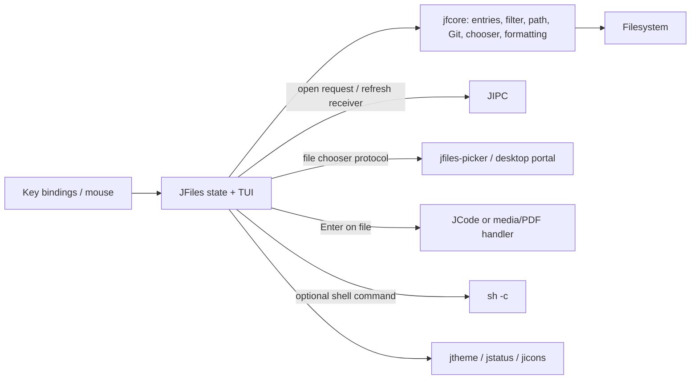

# JFiles and jfcore — terminal file manager and reusable file logic

JFiles is a full-screen `prompt_toolkit` file manager. It combines keyboard-first directory navigation with file operations, previews, Git status, a CLI file chooser, and JDesk/JIPC integration. The UI module owns application state and key handling; `jfcore.py` isolates directory/path/formatting/chooser/Git helpers from screen concerns ([JFiles.py:1-6](../../JFiles.py#L1), [jfcore.py:1-3](../../jfcore.py#L1)).

## System boundary and state model

`Estado` is a single mutable application state object: current folder, all and filtered entries, cursor/scroll position, hidden-file and sort modes, marked paths, internal copy/cut buffer, prompt/confirmation mode, status messages, Git metadata, chooser options/result, and pending open/shell actions ([JFiles.py:71-98](../../JFiles.py#L71)). The UI is organized around this state rather than a tree of per-entry widgets: `jfcore.linha()` returns formatted fragments and JFiles renders a list window from them. This keeps rendering cheap and makes keyboard handlers update a small number of state fields.

Dependencies are mostly optional at the UI boundary: Pillow enables image preview; JIPC enables portal/open/refresh integration; jicons, jtheme, and jstatus provide shared appearance; prompt_toolkit is the TUI framework; `jfcore` is required local logic ([JFiles.py:15-48](../../JFiles.py#L15)).

## Startup and application loop

`main()` parses picker/navigation options, loads recent locations, chooses the initial directory, and registers a JIPC receptor only when this is the JDesk `jfiles` pane (`JDESK_PANE=jfiles`). This guard prevents an independent JFiles launched from JShell from stealing pane messages ([JFiles.py:1128-1138](../../JFiles.py#L1128)). Each application loop refreshes recents and directory entries, starts the async watcher, then handles deferred shell/open actions after the TUI exits ([JFiles.py:1139-1165](../../JFiles.py#L1139)). In picker mode, `finally` always writes a result file (empty means cancellation) so the portal caller does not wait forever ([JFiles.py:1166-1174](../../JFiles.py#L1166)).

Activating a directory navigates into it. Activating a file in picker mode selects or prompts for a save name. In normal mode, it first sends `{cmd: open, path}` through JIPC; if no desk recipient accepts the request, it chooses a local handler: GUI media via `xdg-open`, PDF via `zathura` or `pdftotext | less`, otherwise JCode ([JFiles.py:323-367](../../JFiles.py#L323)). This makes the same file manager useful both inside JDesk and as a standalone shell tool.

## jfcore: filesystem representation and navigation

`Entrada` is the UI-facing record: name, `Path`, directory flag, symlink flag, size, and modification time ([jfcore.py:24-36](../../jfcore.py#L24)). `listar()` uses `os.scandir`, hides dotfiles unless requested, tolerates entries disappearing or broken links, sorts directories first, then applies name/size/date ordering ([jfcore.py:41-66](../../jfcore.py#L41)). `filtrar()` ranks contiguous substring matches ahead of subsequence matches; for example, an abbreviated query can match letters in order without being contiguous ([jfcore.py:69-87](../../jfcore.py#L69)).

Path resolution expands `~` and environment variables and resolves relative input against the current directory. Completion reads the relevant parent directory, hides dotfiles unless the prefix starts with `.`, and either completes one candidate or advances multiple candidates to a common prefix ([jfcore.py:172-215](../../jfcore.py#L172)). Recent folders are stored under `$XDG_STATE_HOME/jdev/jfiles-recentes` or `~/.local/state/jdev/jfiles-recentes`; registration uses a temporary file and `os.replace`, caps the list at 300 entries, and ranks suggestions by visit count ([jfcore.py:217-275](../../jfcore.py#L217)).

The module also owns display-column accounting. `largura()` treats East Asian wide/fullwidth and emoji-like wide characters as two columns and combining marks as zero; `cortar()` truncates/pads by terminal columns, not Python character count ([jfcore.py:108-140](../../jfcore.py#L108)). `linha()` uses this to keep names and optional Git/size/date columns aligned ([jfcore.py:462-486](../../jfcore.py#L462)).

## Operations and keyboard workflows

The default key map is defined directly at [JFiles.py:756-932](../../JFiles.py#L756): arrows/page keys move, Enter activates, Left/Backspace goes up, `~` jumps home, Space toggles a mark and advances, `a` marks/unmarks all visible entries, `/` filters, Ctrl+L or `g` navigates by path, `!` runs a shell command, `n`/`N` create file/folder, `r`/F2 rename, `c`/`x` copy/cut, `p`/Ctrl+V paste, Delete/`D` requests deletion, `d` starts external drag, `y` copies paths, `i` toggles information, `s` cycles sort, `.`/F3 toggles hidden files, Ctrl+R refreshes, `?`/F1 shows help, and Ctrl+Q exits (or cancels picker mode).

The operation target rule is significant: `alvos()` returns all still-existing marked paths, or the item under the cursor if there are no marks ([JFiles.py:108-118](../../JFiles.py#L108)). Copy/cut is an internal in-memory list. Paste chooses collision-free destination names (`name (2).ext`), preserves symlinks when copying, and prevents copying a directory into itself ([JFiles.py:207-245](../../JFiles.py#L207), [jfcore.py:439-456](../../jfcore.py#L439)). Permanent deletion is only used when no trash command exists; the confirmation UI says so explicitly. When possible it uses `gio trash` or `trash-put` ([JFiles.py:246-267](../../JFiles.py#L246), [jfcore.py:431-436](../../jfcore.py#L431)).

## Picker / portal integration

The chooser is not a separate application: `--pick` changes JFiles’ behavior and its return channel. Options include `--multiple`, `--dir`, `--save NAME`, `--save-here`, `--out FILE`, `--start PATH`, and `--title TEXT`; flags that imply selection mode automatically set `pick=True` ([jfcore.py:346-377](../../jfcore.py#L346)). `--out` uses one absolute path per line, and an empty output file signals cancellation; this protocol is explicitly described in `gravar_escolha()` ([jfcore.py:394-400](../../jfcore.py#L394)). `jfiles-picker` is the desktop-facing wrapper documented in the component map; `JFiles` itself handles the interactive selection, prompting, overwrite confirmation, and result.

Directory selection uses Tab: select marked folders if any, otherwise the folder under the cursor, otherwise the current directory. Save mode prompts for a filename and asks before replacing an existing path ([JFiles.py:920-932](../../JFiles.py#L920), [JFiles.py:422-461](../../JFiles.py#L422)).

## Refresh, Git, and state flow

The async folder watcher checks directory mtime every 700ms and refreshes when entries change; a JIPC `refresh` request only sets a thread-safe `Event`, leaving UI state mutation to the application loop ([JFiles.py:1066-1114](../../JFiles.py#L1066)). Git branch/status work runs in an executor and refreshes approximately every 2.8 seconds, with explicit refresh requests able to trigger it sooner. `jfcore.git_marcas()` invokes `git status --porcelain=v1 -z`; `interpretar_porcelain()` maps changed paths to top-level visible entries, preserving the strongest status mark ([jfcore.py:277-344](../../jfcore.py#L277)).

## Practical mastery and developer guide

Use the filter first for local narrowing, then `g`/Ctrl+L for a known path; recent-folder fuzzy matching is useful for moving among frequently visited project trees. Mark multiple paths with Space, then operate on them as one batch. `i` exposes metadata; `s` cycles sort; dot/F3 exposes hidden files. To open a source file in the resident JDesk editor, use Enter in the JDesk JFiles pane; the IPC route hands it to the resident JCode. Standalone JFiles instead launches its own editor/handler.

When extending behavior, put filesystem-independent transformation in `jfcore`; put UI state transition and confirmation in `JFiles.py`. Maintain the `alvos()` target rule consistently, and do not perform long shell/Git work during drawing. For chooser issues inspect argument parsing, `ponto_de_partida`, UI selection behavior, then `gravar_escolha` and the wrapper protocol.

Engineering tradeoffs: directory mtime is a low-cost but filesystem-dependent refresh signal; polling may miss edge cases on unusual filesystems. Internal copy/cut state is process-local and does not integrate with the desktop clipboard. The terminal drag feature depends on optional external executables. Git is intentionally decorative and failure-tolerant. The separated `jfcore` gives testable pure logic, although functions such as Git/recent-state still perform filesystem/process I/O. Tests exist for core and file state, but none were run for this study.
