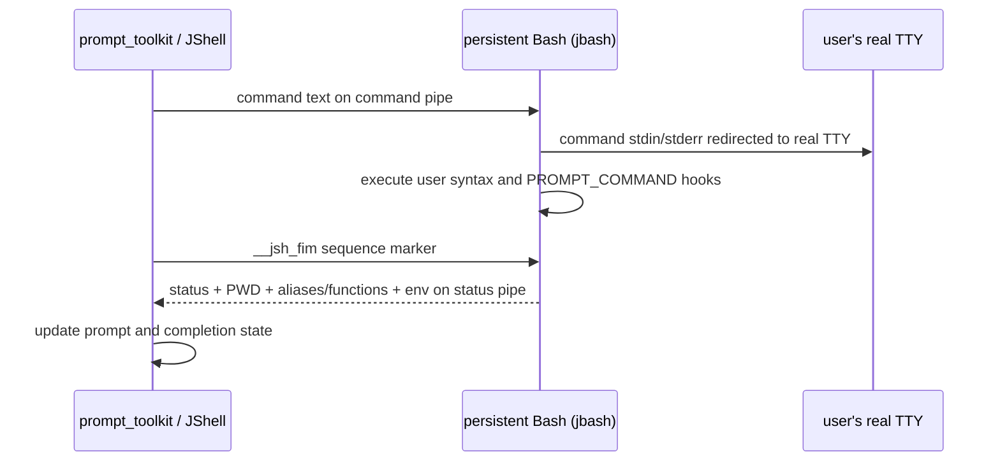

# JShell and jbash — interactive shell with a persistent Bash execution engine

JShell’s architecture is a deliberate split: JShell supplies the prompt, styling, completion, session HUD, and selected “JDev-native” commands; optional `jbash.py` keeps a real interactive Bash process alive to execute the rest of the user’s shell language. This is why JShell can retain a custom interface without reimplementing Bash syntax. The source describes that contract in [jbash.py:2-19](../../jbash.py#L2).

## Startup and session lifecycle

`JShell.main()` prints its greeting, starts the Bash motor unless absent, disabled (`JSHELL_MOTOR=off/0/no`), or unable to initialize, then constructs a `PromptSession` with persistent `~/.jshell_history` when the home directory is writable (otherwise in-memory history). It enables completion on Tab, history suggestions/navigation, custom lexer, and readline-like menu behavior ([JShell.py:2240-2356](../../JShell.py#L2240)). With the motor enabled, Bash reads its rc files; classic mode runs `~/.jshellrc` through JShell’s own evaluator. Ctrl+C cancels the current input/command, Ctrl+D exits, and the `finally` path prints the session HUD summary and closes the motor.

`jbash.Motor.iniciar()` creates a pipe for commands, a separate status pipe, duplicates the real terminal fd, and gives Bash a private pseudo-terminal only for its own stderr. Bash is launched as an interactive, no-job-control process `bash --noediting --rcfile ... -i +m` ([jbash.py:205-273](../../jbash.py#L205)). The private stderr terminal prevents interactive Bash from taking terminal ownership away from prompt_toolkit. For each user command, JShell sends a shell block that redirects interactive stdin/stderr to the real terminal and then sends a private completion marker. Bash reports status, cwd, alias/function names, and environment back over a framed status pipe ([jbash.py:51-112](../../jbash.py#L51)). This preserves `cd`, exports, aliases, functions, and rc-driven environment across commands while still returning control to the TUI.

## Command dispatch: native commands and Bash compatibility

Commands are registered with `@comando`, which adds each entry to both a dispatch dictionary and generated help metadata ([JShell.py:154-162](../../JShell.py#L154)). Native built-ins cover navigation/files, text inspection/search, environment and aliases, Git/open, JCode/JFiles, and shell controls. The complete list and usage is produced by `help` ([JShell.py:544-1309](../../JShell.py#L544)).

When Bash is active, `executar_linha()` first tries a JShell-native implementation only for simple, single-line commands in `NATIVOS_BONITOS`; Bash aliases/functions win where they conflict. A leading `\` or `command` can force system command behavior; `jls` forces JShell’s styled listing. Unknown simple commands are checked for suggestions, then other syntax goes to Bash ([JShell.py:1577-1734](../../JShell.py#L1577)). If the motor is unavailable, a legacy evaluator tokenizes input with `shlex`, expands aliases/globs, supports `;`, `&&`, and `||`, and runs common external-only pipes/redirections natively. Unsupported shell syntax falls back to `sh -c` ([JShell.py:1321-1586](../../JShell.py#L1321)).

Without jbash, JShell is still useful, but it is not a Bash clone: stateful shell constructs and advanced syntax depend on `sh -c` fallback, which means child shell state such as `cd` or `export` does not persist. With jbash, those changes persist in the motor and are reflected back into JShell’s process environment/cwd. This is a key operational distinction, not merely an implementation detail.

## Completion and prompt

The custom `JCompleter` handles command names, JShell commands/aliases, executables on PATH, variables, paths, quote/escape handling, directory-only contexts such as `cd`, and Bash programmable completions where available ([JShell.py:2063-2238](../../JShell.py#L2063)). For programmable completion, JShell sends token/cword context to `Motor.completar`; jbash invokes the command’s registered completion function in its persistent shell and returns candidates/options through the status framing ([jbash.py:115-202](../../jbash.py#L115)). The PATH executable-name cache is invalidated when directory mtimes change ([JShell.py:1597-1631](../../JShell.py#L1597)).

Prompt construction is dynamic: cwd, Git branch, dirty marker, last exit status, and optional root/HUD pills ([JShell.py:1844-1958](../../JShell.py#L1844)). Git branch comes from `.git/HEAD` without spawning Git; dirty status is queried in a daemon worker with a five-second refresh cadence so prompt painting does not wait ([JShell.py:1864-1895](../../JShell.py#L1864)). The session HUD tracks command outcomes, combo, accuracy-like rank, duration, and a life bar; it is presentation/gamification and can be toggled with `hud off` or `JSHELL_HUD=0` ([JShell.py:1742-1842](../../JShell.py#L1742)).

## JDev integrations

`jcode [--aqui] file` resolves paths and either sends an `open` message to JDesk’s JCode pane (then focuses it), or runs JCode as a child process. `--aqui` bypasses desk routing. `jfiles` runs the JFiles program as a child ([JShell.py:497-543](../../JShell.py#L497)). `open` uses the system opener, and `git` invokes Git. Thus JShell and JFiles offer complementary entry points: shell commands for direct navigation and batch work, JFiles for visual selection/preview and portal picking.

Note that JShell imports JIPC only to send JCode open/focus requests; it does not register a pane receiver itself. The JDesk-integrated terminal pane is a JTerm process running JShell, and JTerm/JDesk govern that process lifecycle. JShell’s own startup does not create a second JIPC service.

## Practical operation

Use JShell as the persistent working shell: `cd` and exports remain active when jbash is running; `help` shows native commands; Tab completes commands, paths, variables, and (when installed) Bash completions; `history` uses the same prompt_toolkit history; `jcode file` routes to the resident editor, while `jcode --aqui file` opens locally. `jfiles` opens the visual manager. `ls` is the styled JShell listing when not shadowed by a Bash alias/function; `jls` explicitly selects it. `hud off` removes the optional combo/life display.

For pipelines, ordinary Bash syntax is delegated to the persistent motor. In fallback mode, JShell directly supports straightforward external pipelines and redirection without an intermediary shell, then uses POSIX `sh` for unsupported syntax. Use this fallback model when debugging why a pipeline or shell variable behaves differently on a system without Bash.

## Developer navigation and engineering analysis

For prompt/completion changes, begin around `JCompleter`, token scanning, and prompt builders; for command features, use the decorator and add an implementation under its matching command group. For execution bugs, trace `executar_linha` → native dispatch/unknown check → `MOTOR.executar`, then inspect the sequence-framed command/status protocol in `jbash.Motor`. The protocol’s sequence IDs and locks are there to serialize access and discard stale command responses; do not add concurrent command writes outside that contract.

The useful engineering choice is using Bash as a long-lived subprocess rather than launching a fresh shell for each line. That preserves shell state and completion while JShell keeps its own UI. The cost is a complex fd/TTY/status protocol and dependence on Bash; the legacy path is a real fallback, but with intentionally reduced persistence and syntax fidelity. The JDev-native-command precedence is another deliberate tradeoff: it gives rich listing/help, but Bash aliases/functions must be handled carefully to avoid surprising shadowing. The session HUD and custom themed prompt depend on JShell’s own status model; they should not be confused with JBar’s system metrics.

No commands or tests were run as part of this study.
