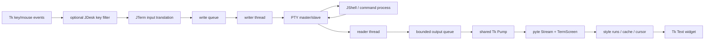

# JTerm: PTY terminal, emulator, and embedded pane widget

JTerm is two products sharing one implementation: a standalone Tk terminal window and `PtyPane`, a reusable terminal widget used by JDesk. Its job is not merely to paint text. It must run a real terminal process, translate input into terminal sequences, interpret output/control sequences, preserve terminal dimensions and history, render styles efficiently, and coordinate process/thread lifecycle. See [Desktop runtime stack](../INTEGRATION/DESKTOP_RUNTIME_STACK.md) for how JDesk hosts it.

## Identity and execution modes

`JTerm.py` runs the JShell when invoked without a command, runs the provided command when arguments exist, and exports the same `PtyPane` class for JDesk (`JTerm.py:1-30`, `:1521-1559`). Standalone `JTerminal` creates one root window and one pane with close-on-success behavior; JDesk creates many `PtyPane` instances with restart-on-exit behavior (`:1521-1556`; `JDesk.py:133-138`).

Dependencies are Tkinter and pyte; `pywinpty` is required for the Windows backend. JTerm imports shared theme colors optionally and falls back to a built-in palette, and optionally imports `jcursor` for DECSCUSR cursor shape decoding (`JTerm.py:44-94`). It deliberately does not require prompt_toolkit itself; that is a dependency of the default JShell child.

## Internal architecture

`PtyPane` combines five responsibilities: a Tk `Frame` and `Text` view; terminal dimensions/font metrics; `pyte.Screen` and `pyte.Stream`; input/selection/scrollback state; and one child process with reader/writer threads (`JTerm.py:243-277`, `:320-430`). The process backend is abstracted as `UnixPty` or `WinPty`, while the rest of the widget API remains common (`:129-240`).

### Terminal process and PTY

On Unix, `UnixPty` opens the PTY pair, sets the initial row/column size, then uses `subprocess.Popen()` with all three standard streams attached to the slave and `start_new_session=True`. Its `preexec` makes the child’s fd 0 the controlling terminal; the parent closes the slave and keeps the master (`JTerm.py:129-148`). The child therefore sees a terminal, not pipes. This is why interactive shells, full-screen terminal programs, terminal colors, cursor control, and programs such as vim can work normally.

Reads decode UTF-8 incrementally with replacement for invalid sequences; writes encode UTF-8 and handle partial OS writes; resize sends `TIOCSWINSZ` to the master (`:148-177`). Closing sends SIGHUP to the child process group and closes the master, falling back to `terminate()` if group signaling fails (`:185-197`). The Windows backend wraps `winpty.PtyProcess` and uses its read/write/resize/terminate API (`:199-240`).

The environment begins as a copy of JTerm’s parent environment, then sets terminal identity (`TERM=xterm-256color`, `COLORTERM=truecolor`), UTF-8/unbuffered Python settings, and a default `JICONES=nerd`; caller-supplied `env_extra` wins last (`JTerm.py:450-467`). In JDesk this final overlay injects IPC endpoint and pane/workspace metadata.

### Initialization waits for usable widget geometry

The widget is created with nominal rows/columns but does not start the child immediately. The first `<Configure>` event waits until its text control is wider than 60 pixels and taller than 40; only then it schedules `start_process()` with `after_idle()` (`JTerm.py:573-584`). `calc_size()` derives rows and columns from actual pixel size and font metrics (`:558-565`). This avoids starting prompt_toolkit at an incorrect default size and sending a disruptive resize immediately afterward.

Subsequent configure events are coalesced into a 60 ms delayed resize. `apply_resize()` updates the emulator and terminal process together (`:585-599`). The custom `_resize_screen()` compensates for behavior in pyte’s row resize: when shrinking it discards blank rows below the cursor first, moves cursor/content together, and sends removed top rows to scrollback; when growing it pulls recent history back into the visible screen where possible (`:601-674`).

## Output decoding and pyte adaptation

`TermScreen` subclasses `pyte.Screen` to handle behaviors JTerm needs around the generic emulator:

- Terminal query responses (such as cursor position reports) are sent back through the PTY callback (`JTerm.py:243-255`).
- Full-screen scroll operations notify JTerm when the top row is about to leave, allowing it to preserve that row in its own scrollback (`:256-261`).
- Erase-display mode 3 clears JTerm’s scrollback as well as the screen (`:263-266`).
- Terminal title changes are forwarded to the standalone window or JDesk header (`:268-270`).

The reader thread places PTY chunks in a bounded queue of 128. If the queue fills, it waits in 200 ms increments rather than dropping output, applying backpressure to the reader thread (`JTerm.py:411-412`, `:481-483`, `:693-705`). The writer thread isolates potentially blocking writes from Tk (`:707-716`). The shared `Pump` scans active panes every few milliseconds while output exists, divides a 12 ms processing budget among panes with output, and uses a 10 ms idle cadence (`:56-58`, `:1491-1518`). Each pane drains only until its assigned deadline; terminal parsing and UI drawing remain on the Tk thread (`:718-749`).

This architecture prioritizes UI responsiveness and bounded per-cycle work. It does not make parsing parallel: all `pyte` mutation/rendering is serialized through the single Tk loop, which avoids races in emulator state.

## Terminal control features beyond pyte defaults

JTerm preprocesses output in `feed()` to recognize two protocol families outside normal pyte behavior (`JTerm.py:774-791`):

1. Alternate screen sequences (`?47`, `?1047`, `?1049` set/reset) are handled by saving the current visible screen/cursor, clearing for the full-screen app, then restoring on exit (`ALT_SCREEN_RE`, `:121`; `set_alt_screen()`, `:793-816`). Full-screen apps do not add their screen contents to ordinary scrollback.
2. DECSCUSR cursor shape sequences (`ESC [ Ps SP q`) are decoded by `jcursor` into block/bar/underline plus blink state (`:121-125`, `:774-790`). Bar and underline cursors are Tk overlay frames; a block cursor is rendered through foreground/background inversion. The blink timer dirties only the cursor row (`:1024-1083`).

Output can be split across read chunks in the middle of an escape sequence. `pending` retains a trailing partial sequence and prepends it to the next `feed()` call (`PARTIAL_RE`, `:121-123`; `feed()`, `:774-791`). This prevents fragmented escape sequences from being misinterpreted as ordinary text.

## Rendering, colors, wide characters, and cache strategy

`pyte.Screen` models cells with character, foreground/background, bold, italic, underline, strike, reverse, and cursor state. JTerm converts a terminal row into contiguous runs of identical style (`line_runs()`, `JTerm.py:907-928`), maps styles to Tk tags with font/style caches (`tag_for()`, `:883-897`), and redraws only rows that pyte marks dirty. It also has a row-render cache so unchanged rows do not cause Tk deletes/inserts (`:930-949`, `:990-1022`).

ANSI and truecolor conversion go through `color()`. For dark themes, black or near-black foreground colors are lifted to a readable ANSI black; black backgrounds remain dark (`JTerm.py:852-873`). Reverse video is applied as XOR between application reverse mode and the block cursor (`:875-881`). Style tags are capped at 1,500; overflow deletes/rebuilds the cache to avoid a large accumulation of distinct truecolor tags (`:56-61`, `:899-905`, `:990-995`).

Terminal columns are cell-based, not Python character counts. `_celulas()` gives wide East Asian characters two cells (second cell represented empty) and appends combining marks/variation joiners to the previous cell (`JTerm.py:299-317`). Emoji fallback fonts may have taller line boxes than the chosen monospace font; JTerm measures actual Tk line height and recalculates rows to prevent clipping (`:951-977`). These details matter when changing rendering: ordinary Unicode length is not terminal column width.

## Scrollback and selection

JTerm maintains up to roughly 5,000 rows of history, separately from pyte’s current screen (`JTerm.py:56`, `:817-835`). It stores historical rows as styled runs. The user scroll offset is an integer number of rows from the live bottom; while scrolled up, new output advances the offset so the viewed content stays stable (`:818-826`). On window growth, history can be pulled back into the screen, and on shrink, rows shifted from the top enter history (`:627-674`).

Selection positions are stored as absolute `(history-row, terminal-column)` values, so selection survives viewport scrolling and lines moving between history and screen (`JTerm.py:380-396`, `:1197-1254`). Single drag selects characters, double-click selects a word based on whitespace and `WORD_STOP`, triple-click selects a line, Shift+click extends selection, and dragging outside the widget auto-scrolls (`:1228-1248`, `:1342-1430`). On X11, a finished selection is also published as the PRIMARY selection for middle-click paste in other apps (`:1432-1453`).

Clipboard actions include Ctrl+Shift+C/V, Ctrl+Shift+A, Ctrl+Insert/Shift+Insert, and Ctrl+C to copy only when a selection exists. Right-click copies when selected, otherwise pastes. Paste converts newlines to carriage returns, strips ESC bytes, and wraps bracketed-paste markers when the terminal has enabled that mode (`JTerm.py:1084-1128`, `:1191-1195`, `:1462-1488`).

## Keyboard translation and host filtering

The widget translates Tk key events into xterm-style escape sequences using modifier parameters, application-cursor mode, and a special-key map (`JTerm.py:99-123`, `:1084-1168`). Arrow/Home/End sequences switch between CSI and SS3 forms according to DECCKM; Shift+Tab becomes reverse-tab; Ctrl+Space becomes NUL; Ctrl+Backspace becomes word erase; Alt prefixes printable characters with ESC (`:1136-1167`). On Windows, Ctrl+Alt printable input is treated as AltGr text rather than a terminal modifier (`:1130-1134`).

The optional `key_filter` runs first. In JDesk it consumes pane-management shortcuts; otherwise the translated bytes are placed on the write queue. Modifier-only events are swallowed, preventing Tk’s Text widget behavior from leaking into the terminal (`:1085-1105`).

## Process exit and pane states

JTerm tracks `started`, `destroyed`, `dead`, `waiting_close`, and `waiting_restart` separately (`JTerm.py:403-412`). These are not redundant: a dead program may still have a visible terminal pane; a destroyed widget must ignore late thread/UI callbacks; a restart-mode pane can be dead but restartable.

- In `exit_mode="close"`, a successful exit closes through `on_close`; a nonzero exit displays a message and waits for Enter/Escape when `KEEP_OPEN_ON_ERROR` is enabled.
- In `exit_mode="restart"`, exit always leaves a message and waits for Enter to restart.
- JDesk’s Alt+Shift+Q invokes `encerrar()` which closes the PTY and leaves a restartable stopped pane; Alt+Shift+R calls `restart()` immediately.

`kill_process()` sets the I/O stop event, wakes the writer via a sentinel, calls backend close, and clears the PTY reference (`JTerm.py:485-510`). `shutdown()` additionally marks the widget destroyed, cancels cursor blink, kills the process and destroys the Tk frame (`:512-526`). Reader/writer threads are daemon threads; lifecycle safety therefore depends on setting stop/closing the PTY before destroying the widget.

## Standalone usage and practical workflows

- `python3 JTerm.py` opens JShell in a 900×580 Tk window.
- `python3 JTerm.py htop` (or any command argv) runs that command in a real PTY.
- Inside JDesk, each terminal pane uses the same emulator; per-pane Ctrl+wheel zoom does not alter other panes.
- Shift+PageUp/Down or mouse wheel scrolls terminal history; selection survives scroll.
- Full-screen terminal programs use alternate-screen handling; their screen is restored away on exit rather than added to scrollback.
- If an app’s cursor appears wrong, inspect its DECSCUSR sequence, `jcursor.decscusr()`, and the overlay/block cursor render path.
- If prompt layout glitches on resize, inspect `apply_resize()` and `_resize_screen()` before changing pyte behavior.

## Developer navigation and limits

For an input bug: `on_key()` host filter → key/modifier map → write queue → backend write. For missing output: backend `read()` → reader thread → bounded queue → `Pump.tick()` → `drain()` → `feed()`/pyte → dirty-row renderer. For geometry errors: Tk Configure → `calc_size()` → custom screen resize → backend `TIOCSWINSZ`.

The implementation is a large single module because standalone and embedded terminal behaviors share low-level state. The pure screen/PTY layers, widget, and Pump are clear conceptual seams, but currently live together. Focused tests for JTerm were not found in root tests; no tests were run. `jterm_diag.py` exists as a diagnostic tool, while CI’s visible coverage is mostly helper-oriented.

Key engineering tradeoffs visible in source:

- Tk Text is used as a cell grid rather than drawing every glyph on a Canvas. It provides selection/text integration but demands careful row-height and tag-cache handling.
- A single UI Pump avoids one timer per pane but distributes a fixed work budget; very heavy output may take multiple ticks to catch up.
- Scrollback is custom to preserve styling and selection coordinates, adding resize/alternate-buffer complexity.
- Full terminal compatibility is not implied by pyte plus these extensions; uncommon escape sequences and terminal protocols remain potential compatibility limits.

Remember that JTerm is both a user-visible terminal and a foundational UI runtime for JDesk. A change to process lifecycle, focus, key filtering, or widget resize behavior can affect every pane application.
