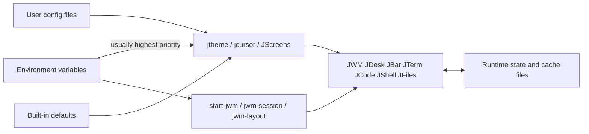

# Configuration and persistent state map

This Stage B chapter distinguishes settings that change behavior from state that programs derive, cache, or exchange at runtime. The paths below come from source, not only the README. The main lesson is that JDev currently uses several storage conventions: XDG directories for many newer modules, legacy dotfiles for JShell, and a few fixed paths that do not follow XDG overrides.

## Configuration precedence and flow

The theme has a clear explicit precedence: `JTHEME` environment variable, then `$XDG_CONFIG_HOME/jdev/theme` (or `~/.config/jdev/theme`), then built-in Tokyo Night (`jtheme.py:148-172`). Font selection similarly checks `JFONT`, then `jdev/font`, then its installed-font preference list (`jtheme.py:185-203`). JCode cursor preferences are loaded from `jdev/jcode.json` and validated against defaults; `jcursor.py` writes via temp file plus `os.replace` (`jcursor.py:32-61`).

Runtime environment also shapes behavior: `JWM_ANIM`, `JWM_ANIM_MS`, and `JWM_FOCUS_FOLLOWS_MOUSE` control WM behavior (`JWM.py:60-91`); `JWM_VGA_MODE/RATE/ROTATE`, `JSCREENS_CONFIG`, and `JWM_WALLPAPER` affect display setup (`jwm-layout:10-15`); `JSHELL_MOTOR` can disable the hidden bash motor (`JShell.py:2253-2265`); `JDESK_SOCK/TOKEN/WS/PANE` identify a pane’s IPC session (`jipc.py:40-60`). JDesk propagates the JIPC endpoint to its pane child processes at launch (`JDesk.py:133-137`).

## State inventory

| Data | Path / source | Purpose and lifetime |
|---|---|---|
| Selected theme | `$XDG_CONFIG_HOME/jdev/theme` or `~/.config/jdev/theme` | Durable user choice; `JTHEME` overrides it for a process/session. |
| Preferred font | `$XDG_CONFIG_HOME/jdev/font` or `~/.config/jdev/font` | Durable preference; `JFONT` overrides it. |
| JCode cursor shape/blink | `$XDG_CONFIG_HOME/jdev/jcode.json` or `~/.config/jdev/jcode.json` | Durable validated JSON; default is blinking bar cursor. |
| Saved monitor layout | `JSCREENS_CONFIG`, else `$XDG_CONFIG_HOME/jdev/screens.json` | Durable display configuration; `jwm-layout` tries it on session start/hotplug and falls back to its own layout if unavailable/invalid. |
| Wallpapers | `$XDG_CONFIG_HOME/jdev/` (`horizontal.*`, `vertical.*`, `wallpaper.*`, or other image) | Durable image inputs; `JWM_WALLPAPER` can override with one path. |
| Wallpaper-derived theme cache | `$XDG_CACHE_HOME/jdev/wallpaper-theme.json` | Reuses derived accent/chrome when image signature and base theme are unchanged. |
| JWM→JBar runtime state | `$XDG_CACHE_HOME/jwm-state.json` | Current PID, bar visibility, mode/split, active title/workspace, used workspaces; deleted by orderly JWM shutdown. |
| JToast notification count snapshot | `$XDG_CACHE_HOME/jtoast-state.json` | Notification process PID and visible count; written atomically by JToast. JToast’s docstring says JBar uses it, but no reader exists in the current `JBar.py` or repository search. |
| JRun app list cache | `$XDG_CACHE_HOME/jdev/jrun-apps.json` | Cached discovered `.desktop` entries to make the launcher appear immediately. |
| JRun usage ranking | `$XDG_STATE_HOME/jdev/jrun-uso.json` | Durable app-use counts used to rank search results. |
| JFiles recent directories | `$XDG_STATE_HOME/jdev/jfiles-recentes` | Durable visit counts for quick path lookup; caps at 300 entries. |
| JShell history | `~/.jshell_history` | Durable prompt_toolkit command history; falls back to memory when home is not writable. |
| JShell startup commands | `~/.jshellrc` | Legacy startup file read line by line by JShell; with its bash motor, the bash engine also has its own initialization path. |
| JWM Python log | `~/.cache/jwm.log` | WM plus child stdout/stderr log; fixed `Path.home()` path. |
| JWM session/layout log | `$XDG_CACHE_HOME/jwm-session.log` | Shell-side display/session diagnostics; honors XDG cache override. |
| JCode internal error log | `~/.jcode-erros.log` | Error trace file, truncated when it exceeds 512 KiB. |
| JRun single-instance lock | `$XDG_RUNTIME_DIR/jrun.lock`, else `/tmp/jrun.lock` | Ephemeral PID lock; removed by the owning process when it exits normally. |
| JDesk pane arrangement | In-memory `Workspace` objects | Four workspaces, each lazily initialized and retained only for the JDesk process lifetime; not persisted across sessions (`JDesk.py:110-138`, `:322-352`). |
| JWM windows/workspaces/layout trees | In-memory `Client`, `Workspace`, `Arvore` structures | Rebuilt from currently mapped X windows at WM startup; no tiling/session restore file is visible in the traced code (`JWM.py:94-117`, `:135-177`, `:462-471`). |

The XDG state/cache functions are implemented in `jrcore.py:141-168`, `jfcore.py:216-251`, and `JWM.py:79`; JBar and JToast read their state paths from XDG cache helpers (`JBar.py:393-395`, `JToast.py:324-337`).

## How runtime state crosses process boundaries

Two file protocols matter in the desktop stack:

1. **JWM writes `jwm-state.json`; JBar polls it.** This publishes current WM state as a read-only snapshot. It is written only on change via a temporary sibling and `os.replace` (`JWM.py:387-408`). JBar watches mtime, validates writer PID, and updates UI state (`JBar.py:499-536`).
2. **JToast writes `jtoast-state.json`.** The state includes PID and count and is atomically replaced (`JToast.py:324-339`). Although the JToast docstring calls this “state for JBar” (`JToast.py:19`), the current JBar source does not read the file (`JBar.py:499-536`, `:571-607`), and repository-wide search finds no consumer. Treat it as a currently unconsumed snapshot unless a consumer exists outside this checkout. It is separate from JIPC and separate from JWM state.

JIPC is not persistent storage. Its endpoint and secret token are generated at JDesk startup and passed to pane child environments (`jipc.py:153-173`; `JDesk.py:308-309`, `:133-137`). JDesk restart creates a new port/token, invalidating old endpoint state by construction.

The monitor settings path is another configuration-to-runtime flow: JScreens saves JSON through a temp file and atomic replace (`tools/JScreens.py:42-68`); `jwm-layout` reads the configured file path, invokes `JScreens.py --apply`, and continues with its fallback arrangement if that fails (`jwm-layout:45-56`, `:115-146`). The wallpaper script then selects images based on actual post-rotation monitor geometry (`jwm-wallpaper:1-18`, `:94-163`).

## Storage conventions and inconsistencies

### XDG support is broad but incomplete

Most theme, monitor, cache, and application state paths honor `XDG_CONFIG_HOME`, `XDG_CACHE_HOME`, or `XDG_STATE_HOME`. But important exceptions are visible:

- `JWM.py` stores `jwm.log` at `Path.home()/'.cache/jwm.log'`, even though its runtime state file honors `XDG_CACHE_HOME` (`JWM.py:43`, `:79`). Meanwhile shell session/layout logs honor `XDG_CACHE_HOME` (`jwm-session:11-14`; `jwm-layout:18-20`). A custom XDG cache therefore splits the WM log from other session data.
- JShell keeps its history and rc at `~/.jshell_history` and `~/.jshellrc`, not under XDG (`JShell.py:56-57`, `:2240-2250`, `:2301-2304`).
- JCode writes its internal error log to `~/.jcode-erros.log` (`JCode.py:864-883`).
- The JRun lock uses `$XDG_RUNTIME_DIR` but falls back to shared `/tmp`; the implementation has PID identity checks, but this still differs from cache/state path conventions (`JRun.py:53-84`; `jrcore.py:202-218`).

This matters when diagnosing “missing” state: inspect the actual helper/path function for the component, not only `$XDG_*` environment values or the README’s default paths.

### Atomic writes and resilience

JWM, JRun, JFiles recents, JCode cursor settings, JScreens config, JToast state, and wallpaper-theme cache use temp files/replacement in several places. This reduces the chance readers observe partially written JSON/text. However, these files have different validation and cleanup policies: JWM deletes its state on normal shutdown, while a crash can leave a stale file; JBar validates PID to reject dead writers; JToast state has a PID field, but its consumer validation should be verified in JBar’s notification rendering path. Do not infer one file’s lifecycle from another’s.

## Practical configuration workflow

- To select a stable theme: `python3 jtheme.py set gruvbox`; this writes the XDG config theme file and applies on next process/session startup. A process-level `JTHEME=dawn` takes precedence.
- To choose a font: set `JFONT` for a temporary override or save a family name in the config `jdev/font` file. JTerm/JBar/JRun select only fonts installed in their Tk font list.
- To configure monitors: use JScreens to save a layout, then `jwm-layout` applies it at startup and hotplug. Set `JSCREENS_CONFIG` if managing a non-default config file.
- To troubleshoot a stale bar or notification count: compare the JSON PID with a live process, then inspect which `$XDG_CACHE_HOME` each app inherited.
- To preserve or move a JDev profile: include `~/.config/jdev`, `~/.local/state/jdev`, relevant XDG cache entries if desired, plus JShell’s two home dotfiles and JCode’s error log only if you want that diagnostic history. These paths represent different categories and have different recovery value.

## Follow-up items

- Determine whether the unconsumed JToast state file is a planned integration, a removed feature, or intended for an external consumer.
- Inspect actual JShell bash-motor startup-file behavior relative to `.jshellrc`.
- Check whether JWM should honor XDG cache for its main log; this is an audit observation, not a source change.
- Determine whether JWM/JDesk layout and workspace state intentionally reset each session.
- Inventory durable configuration/state for JClass and every optional tool during their later component study.
