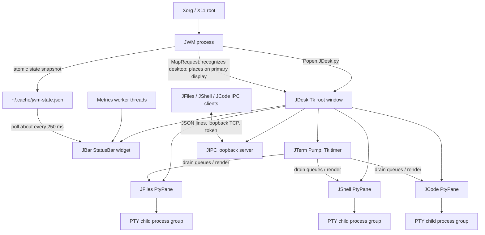

# Desktop runtime stack: JWM, JDesk, JTerm, JBar, and JIPC

This Stage B architecture chapter explains how the window manager, desktop, embedded terminal panes, bar, and process messaging fit together. It complements the [JWM and tiling chapter](../COMPONENTS/JWM_AND_TILING.md); it is an architecture trace rather than the full Stage C component-by-component course.

## The runtime as processes and windows

The crucial distinction is that JDesk’s panes are not separate X windows and do not have separate processes for their UI. They are `PtyPane` Tk frames inside one JDesk root. Each frame owns a child process attached to a pseudo-terminal. JWM manages the single JDesk root as a desktop window; it does not manage each pane. Evidence: `Workspace` creates each pane under one `tk.Frame` (`JDesk.py:116-138`), JTerm’s `PtyPane` subclasses `tk.Frame` (`JTerm.py:320-333`), and JWM recognizes the JDesk X window as a special desktop (`JWM.py:502-505`, `:529-554`).

## Startup and workspace creation

1. JWM starts JDesk via `Popen([python, JDesk.py], start_new_session=True)` and stores the process handle (`JWM.py:230-243`).
2. JDesk creates one Tk root, sets its title to `JDesk`, then constructs its JIPC server before any workspace panes. This ordering ensures each pane receives the server address and token when its child environment is built (`JDesk.py:300-309`, `:519-523`).
3. JDesk creates metrics workers, its in-root JBar widget, and the content frame. Four workspace slots start as `None`; switching to workspace 1 creates its `Workspace` object, then shows it (`JDesk.py:313-328`, `:340-352`).
4. A `Workspace` contains three slots and creates JFiles, JShell, and JCode `PtyPane` widgets (`JDesk.py:110-138`). Each pane receives `JDESK=1`, its pane name, 1-based workspace number, and JIPC connection environment values.
5. Pane subprocess creation waits until the terminal text widget has a meaningful measured size (`JTerm.py:320-328`, `:573-584`). This avoids launching the shell with a guessed 24×80 PTY and then immediately resizing it.
6. On its first `MapRequest`, JWM recognizes the root window by title/class/window type, marks it desktop, moves it to the primary monitor, lowers it behind ordinary clients, and reserves the JBar height (`JWM.py:502-505`, `:529-554`, `:325-334`).

Workspaces are lazy but persistent during the JDesk process. JDesk creates a workspace’s three applications only on first visit; when hidden, it removes that frame from view but leaves the PTYs running and tells panes they are not visible (`JDesk.py:340-352`, `:141-149`). The shared Pump continues to inspect panes from every created workspace (`:336-337`). It consumes output while hidden, but `PtyPane.drain()` only redraws when `visible` is true (`JTerm.py:722-749`). Thus switching workspaces preserves process/editor state and avoids hidden terminal rendering work.

### Example workflow

On first startup, workspace 1 initializes JFiles, JShell, and JCode. You open a project and edit a file; then Alt+2 creates workspace 2 and starts another set of three child programs. Switching back to workspace 1 reveals its existing editor and shell state because JDesk hid the frames but did not shut down those pane processes. JWM’s separate workspaces move whole top-level windows (such as external editor dialogs); JDesk’s Alt+1..4 changes the pane group inside the desktop. These are two different workspace systems.

## JWM ↔ JDesk: desktop window and reserved bar strip

JDesk initially requests a Tk geometry of 1400×820, but JWM later configures the mapped JDesk window to the primary monitor’s actual rectangle, sets border width zero, and lowers it (`JDesk.py:301-306`; `JWM.py:325-334`). JWM recognizes JDesk using any one of: exact title `JDesk`, a class containing `jdesk`, or the desktop window-type atom (`JWM.py:502-505`). This name-based contract means title/class changes can affect WM behavior unless the type predicate also matches.

The bar in the normal integrated session is a child widget at the bottom of JDesk. JWM subtracts the bar height from tiled/floating usable area only when the JDesk desktop window has been discovered and the bar is considered visible (`JWM.py:380-385`, `:676-692`). The bar is not a dock overlay over applications. Toggling Super+Shift+B changes JWM’s state; JDesk’s `StatusBar.poll_estado()` notices it and packs or unpacks the widget, while JWM immediately reallocates the strip (`JDesk.py:315-334`; `JBar.py:499-536`).

The state bridge is deliberately simple and one-way:

- JWM serializes bar visibility, resize mode, pending split, active title, workspace number and used workspace indices; solo mode adds `bar_rect`. It writes a temp file and atomically replaces the state file only when its JSON changes (`JWM.py:387-408`).
- JBar polls file modification time about every 250 ms, validates that the writer PID is alive, and in solo mode also checks the expected WM PID before accepting state (`JBar.py:418-443`, `:499-536`).
- In normal mode JDesk’s bar uses its direct `on_select` callback to switch internal workspaces. In solo mode JBar is an override-redirect window, reads `bar_rect`, and asks JWM to change its X11 workspace through `_NET_CURRENT_DESKTOP` (`JBar.py:805-845`; workspace request at `:194-211`).

This state file is not the JDesk IPC channel. It is a read-only projection from JWM to JBar. That separation is why solo JBar can operate without JDesk or a JIPC client session.

## JDesk ↔ JTerm: UI loop, PTY, and emulation

JTerm is both a standalone terminal window and the reusable implementation of embedded terminal panes. In embedded mode, each `PtyPane` constructs a PTY backend, `pyte.Screen`/`pyte.Stream` emulator, Tk Text display, input bindings, selection/history/render caches, and process flags (`JTerm.py:243-277`, `:320-450`).

On Unix, `UnixPty` opens a PTY master/slave pair, sets the terminal dimensions, then launches the pane command with stdin/stdout/stderr attached to the slave and `start_new_session=True`; `preexec` makes the child’s fd 0 its controlling terminal (`JTerm.py:129-148`). It closes the parent’s slave copy and retains the master. Terminal output is incrementally decoded as UTF-8; writes go to the master; resize uses `TIOCSWINSZ` (`:150-177`).

Each pane has a reader thread moving PTY output into a bounded queue, a writer thread draining user input to the PTY, and the Tk-owned `Pump` consumes output in a time budget. The queue is bounded at 128 chunks to apply backpressure if UI rendering falls behind (`JTerm.py:457-483`). Pump shares `FEED_BUDGET` among panes with pending output and schedules itself faster while busy, slower while idle (`JTerm.py:57-58`, `:1491-1518`). The expensive/blocking process I/O therefore avoids the Tk event thread; emulation and widget painting stay on the UI thread.

JDesk gives panes `exit_mode="restart"`; a child exit leaves the pane visible with an Enter-to-restart message. The standalone JTerm window uses `exit_mode="close"`; a successful process exit closes the window, while an error can stay visible for inspection (`JDesk.py:133-138`; `JTerm.py:751-771`, `:1521-1556`). JDesk owns global Alt shortcuts through each pane’s `key_filter`; JTerm calls the host first, and only forwards unconsumed key events to the PTY (`JTerm.py:1084-1105`). This lets Alt+workspace/focus/resize commands coexist with terminal keyboard input.

Closing/restarting a pane sets its I/O stop event and closes its PTY. On Unix, the PTY backend sends SIGHUP to the child process group, falling back to terminate if that fails (`JTerm.py:485-525`, `:185-197`). JDesk’s explicit shutdown iterates every created workspace, calls each pane’s shutdown, stops Pump/bar/metrics, closes JIPC, and destroys the Tk root (`JDesk.py:499-516`).

## JIPC: the command path between pane programs and JDesk

### Session setup and routing key

`Servidor` binds a TCP socket to `127.0.0.1` on an ephemeral port, listens, and creates a 128-bit random hex token. Its `env()` returns `JDESK_SOCK` and `JDESK_TOKEN`; each pane adds `JDESK_WS` and `JDESK_PANE` (`jipc.py:153-173`; `JDesk.py:133-137`). A client without both address and token is outside a JDesk session: `disponivel()` is false and `enviar()` returns false rather than raising (`jipc.py:40-53`, `:74-89`).

Each JSON-lines command includes the token plus default `ws` and `de` sender fields (`jipc.py:56-61`). Server connections are accepted on a daemon thread, and each connection gets a handler thread. The handler checks the token with constant-time `hmac.compare_digest`; `register` connections are held under `(workspace, program-name)` keys so the server can push messages back into that specific pane (`jipc.py:189-237`).

### Thread ownership and request/response

JIPC’s socket threads do not mutate Tk widgets. For ordinary command messages, the handler puts `(message, connection)` into a thread-safe queue; JDesk polls that queue from its Tk loop every 30 ms and calls `tratar_ipc()` there (`jipc.py:224-227`; `JDesk.py:354-364`). JDesk replies on the same request connection with `{ok, erro}` (`jipc.py:240-246`; `JDesk.py:386-414`). This is a small actor-like boundary: socket workers do network I/O, the Tk main loop owns GUI state.

The implemented commands are:

| Command | JDesk behavior | Typical use |
|---|---|---|
| `open` | Validate path; route by explicit target or extension. PDF/slide extensions open embedded JSlides; other files default to the resident JCode pane. | JFiles/JShell asks the desktop to open a file. |
| `focus` | Focus target pane only if its workspace is currently visible; exits viewer/maximized state if needed. | Return focus from editor to file list. |
| `refresh` | Broadcasts a refresh message to registered JFiles panes. | Refresh after an external file operation. |

`open` is not automatically a “switch to originating workspace” operation. `ws_da_msg()` uses a valid already-created workspace number or falls back to the current workspace; then `focar()` only focuses if that workspace is already the visible one (`JDesk.py:366-384`, `:386-414`). The sender thread and receiver pane are separated: JCode and JFiles callbacks run in their JIPC receiver threads and signal/enqueue work; GUI changes happen in their own app loops (e.g. JCode appends a request to `PEDIDOS`, `JCode.py:2044-2048`; JFiles sets `refresh_pedido`, `JFiles.py:1111-1114`).

`Receptor` reconnects when its connection ends and invokes the callback in its own daemon thread (`jipc.py:91-147`). `enviar()` uses a short timeout and returns a boolean. The initial JDesk request response means the server accepted/routed a message; for `open` routing to a pane, `entregar()` returns true after writing to the registered socket, not after the receiver has completed opening the file (`jipc.py:248-262`). This is an important operational distinction between transport delivery and application-level completion.

### A file-open trace

1. A pane app calls `jipc.enviar({"cmd":"open", "path": ...})`; the helper adds token, workspace, and pane metadata and waits briefly for JDesk’s `{ok, erro}` response.
2. JDesk’s server verifies the token and queues the message; the Tk loop processes it.
3. JDesk selects the embedded viewer for `.pdf/.ppt/.pptx/.odp`, otherwise `jcode`; explicit `target` can override that route.
4. Viewer opens directly inside the JDesk workspace. JCode receives a push message through the persistent JCode Receptor; JDesk focuses the pane when requested.
5. JCode opens/edits the path and, after returning to idle, sends `focus` to JFiles so the user can continue file navigation (`JCode.py:2137-2174`).

This chain makes JFiles + JCode + JSlides feel like one workflow while each remains its own program and JDesk owns the visual coordination.

## Shutdown paths and process ownership

There are distinct shutdown paths:

- **User closes JDesk with Alt+Shift+E / window close:** JDesk lists live panes and asks for confirmation. On acceptance, it closes JIPC, stops UI timers/metrics, calls every pane’s `shutdown()`, then destroys the root (`JDesk.py:467-469`, `:499-516`).
- **User exits JWM with Super+Shift+Q:** JWM’s `shutdown()` calls `terminate()` on the JDesk process and waits 1.5 seconds before `kill()` (`JWM.py:1427-1465`). This does not call JDesk’s Python `close()` method or show its confirmation dialog.
- **JDesk child process exits normally:** its pane is configured to remain in restart mode; user can press Enter or use Alt+Shift+R (`JTerm.py:751-771`; `JDesk.py:481-492`).
- **Standalone JBar in clean mode:** it watches the expected JWM PID every two seconds and destroys itself when JWM disappears (`JBar.py:802-859`).

An architectural follow-up deserves runtime verification: each Unix PTY command is launched in a new session (`JTerm.py:143-146`), while JWM explicitly terminates only the JDesk process (and solo bar), not pane process groups (`JWM.py:1446-1458`). The PTY backend’s normal close path sends SIGHUP to each group, but abrupt JDesk termination does not invoke that path in Python. Closing PTY masters or tearing down X may affect children, but source inspection alone does not prove the exact outcome. Treat pane-process survival on WM exit as an unresolved lifecycle question and verify safely in an isolated Xephyr session before relying on it.

JDesk’s close prompt itself is a meaningful safety feature for deliberate user closure: it lists the running pane programs. JWM session exit currently bypasses that UI path, apparently because JWM owns the parent lifecycle. The code establishes the bypass; whether that is intentional and how children respond remain open engineering questions.

## Practical debugging map

| Symptom | Trace these points first |
|---|---|
| JDesk window floats/tiles instead of acting as background | `JDesk` window title/class/type → `JWM._is_desktop()` → `manage()` special case. |
| Bar overlays a client or leaves a gap | `JWM._bar_bottom()` and `arrange()` → `jwm-state.json` → `JBar.poll_estado()` / JDesk pack callback. |
| Pane appears but no shell starts | `PtyPane.on_configure()` real-size gate → `start_process()` → backend Popen/logical command path. |
| Pane freezes while output is busy | reader queue capacity → Pump per-pane budget → `drain()`/render; verify blocking work did not move onto Tk thread. |
| Open-file request reports failure | child environment (`JDESK_SOCK/TOKEN/WS/PANE`) → token validation → receiver registration → JDesk queue/poll → `target` route. |
| Request reports success but file is not ready | Current IPC acknowledgement means socket write/route succeeded, not that app processing completed. |
| Pane state disappears on workspace change | `Workspace.hide()` only hides frames; check for explicit `shutdown()` or process-exit state instead. |
| Extra shell process after ending session | Compare JDesk normal `close()` with JWM `shutdown()`; trace PTY master close and process groups in an isolated session. |

## Engineering conclusions: facts and inferences

**Facts from source:** JDesk is one desktop X window; the panes are child Tk frames; each pane runs its own PTY child; four JDesk workspaces are lazy and retained; JIPC is loopback TCP with an ephemeral port/token and JSON-lines framing; socket workers queue work for Tk; JWM-to-JBar state is a separate atomic JSON file; JDesk explicit close is more graceful than JWM’s process termination path.

**Engineering interpretation:** these boundaries keep the stack modular and let terminal apps run independently, but the desktop’s correctness depends on shared environment metadata and lifecycle contracts. There are two separate workspace systems, two IPC-like mechanisms (JIPC commands and JWM state file), and three UI/event loops (JWM’s X event loop, JDesk’s Tk loop/Pump, and each terminal app’s own loop). When debugging, first identify which process and which workspace system owns the behavior.

**Open for further study:** prove JWM/JDesk/Pty child shutdown behavior in an isolated display; inspect all client Receptor stop paths; determine whether message transport should ever provide application completion acknowledgements; map focus restoration when file open originates from a noncurrent workspace; inspect `jwm-state.json` cleanup when JWM crashes instead of shutting down normally.
