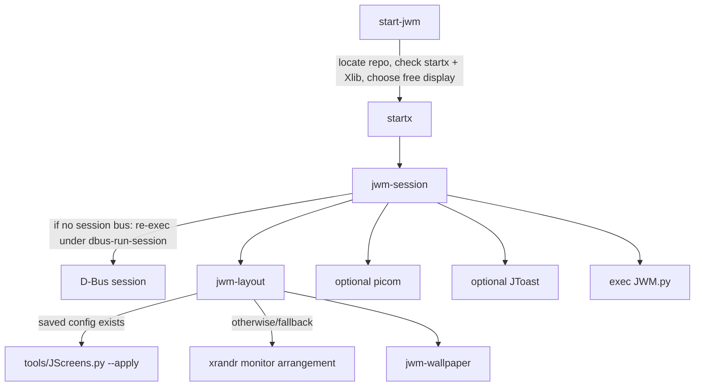

# Session scripts, monitors, wallpaper, and file chooser integration

The scripts around JWM are the operational glue between a login shell, Xorg, desktop services, and the Python programs. They also define important failure behavior: optional features should log and allow the WM to start where possible.

## Startup chain

`start-jwm` resolves its path through symlinks, verifies `startx` and Python Xlib, chooses the first unused X socket from `:0` through `:9`, and replaces itself with `startx ... jwm-session ... -nolisten tcp` ([start-jwm:1-38](../../start-jwm#L1)). Its usage comment says `--no-ui` means no JDesk and no JBar, but actual JWM argument behavior differs: current `JWM.py` has a clean mode that launches standalone JBar without JDesk; `--bare` omits both. The CLI/help mismatch was captured in the JWM chapter and should be understood before relying on the wrapper comment.

`jwm-session` creates a D-Bus session with `dbus-run-session` only when no bus address exists, then logs startup to `$XDG_CACHE_HOME/jwm-session.log` or `~/.cache/jwm-session.log`. It sets cursor defaults, attempts `jwm-layout`, optionally starts picom if installed and configured (trying xrender if the configured launch dies quickly), starts JToast only with a session bus and importable jeepney, then `exec`s JWM ([jwm-session:1-51](../../jwm-session#L1)). The `exec` preserves signal/process ownership for the WM as the foreground session process.

## Monitor arrangement and hotplug

`jwm-layout` is called at login and by JWM on monitor-change events. It queries xrandr, identifies connected/disconnected outputs, and first looks for a saved JScreens JSON file. If found, `tools/JScreens.py --apply` is authoritative; a failed apply falls back to the script’s default arrangement ([jwm-layout:39-66](../../jwm-layout#L39)). Otherwise it chooses an HDMI-prefixed output as primary where possible, places it first, orders other outputs to the right, gives VGA a configurable mode/rate/rotation, uses `cvt` to add a mode when needed, and falls back to `--auto` if custom mode application fails ([jwm-layout:68-145](../../jwm-layout#L68)). Disconnected outputs are turned off. This policy is environment-specific but configurable through `JWM_VGA_MODE`, `JWM_VGA_RATE`, `JWM_VGA_ROTATE`, and `JSCREENS_CONFIG`.

After layout, the script calls `jwm-wallpaper`. The wallpaper script selects a single `JWM_WALLPAPER` image or per-orientation images under `$XDG_CONFIG_HOME/jdev` (horizontal/vertical, with generic fallbacks), reads actual post-rotation monitor geometry from xrandr, and applies with xwallpaper per output when available, then feh, then hsetroot ([jwm-wallpaper:1-174](../../jwm-wallpaper#L1)). The wallpaper is on the X root; JDesk covers the primary monitor, so it is most visible on secondary screens. All paths log to the session log and generally fail softly.

`scripts/xephyr-test.sh` is the isolated manual path: it requires an existing X display and Xephyr, finds a free nested display, starts Xephyr, and launches `JWM.py` inside it, cleaning the Xephyr process on exit ([scripts/xephyr-test.sh:1-33](../../scripts/xephyr-test.sh#L1)). It is the safe place for future visual/shutdown experiments; no such runtime test was run during this study.

## File chooser portal bridge

`jfiles-picker` implements the command shape expected by `xdg-desktop-portal-termfilechooser`: flags for multiple/directory/save, suggested path, and output file. It truncates the output file first so errors/cancellation produce an empty response, builds a JFiles `--pick --out` invocation, maps flags to `--multiple`, `--dir`, `--save`/`--start`, and runs it inside JTerm by default ([jfiles-picker:1-25](../../jfiles-picker#L1)). `JPICKER_TERM` can replace JTerm with an explicit terminal command.

JFiles writes selected paths one per line and always writes even on cancellation. The desktop portal wrapper and JFiles therefore agree on a file-based result protocol, while the UI interaction stays inside JFiles. Installation and portal configuration steps are documented separately in [INSTALAR-SELETOR.md](../../INSTALAR-SELETOR.md); the implementation supports the portal protocol described there.

## Operational debugging

For startup failures, inspect in order: `start-jwm` prerequisite and free-display checks; `jwm-session.log`; `jwm-layout`/wallpaper messages; JWM log; then whether optional D-Bus/picom/jeepney components were started. For monitors, compare saved `screens.json`, environment overrides, and current xrandr output. For portal chooser hangs, confirm the wrapper gets all five positional arguments and that JFiles writes the supplied output path on every exit path.

The script layer uses shell operations where they fit (Xorg/session setup) and Python for application logic. Most optional integration failures are non-fatal and leave a log message. The principal maintenance risk is duplicated documentation/usage: `start-jwm`’s comment conflicts with current JWM mode semantics, and deployment paths such as `INSTALAR-SELETOR.md` are user-specific examples.
