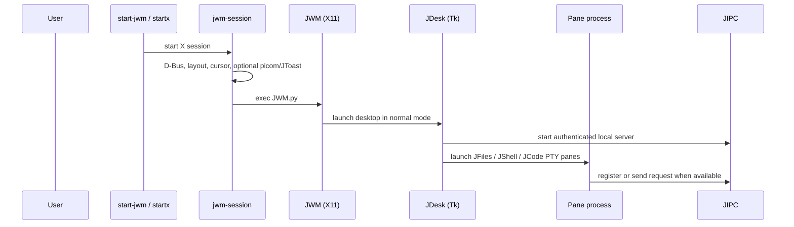
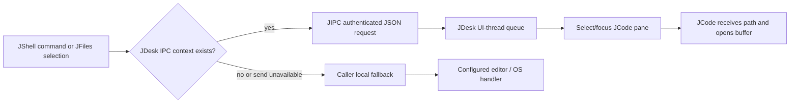

# JDev workflows as a connected system

This chapter turns the component studies into end-to-end paths. It focuses on who owns each state transition and what the handoff actually guarantees. The diagrams describe the checked-out implementation, not a claim that every optional dependency is installed.

## 1. Start a desktop session and reach a working pane

The ownership split matters: JWM owns top-level X windows, focus, workspaces and tiling; JDesk owns its own pane/workspace arrangement; embedded JTerm instances own PTYs and terminal emulation. A “workspace” can therefore refer to two distinct models. Window movement is a JWM concern; switching the set of JDesk panes is a JDesk concern. See [JWM and tiling](../COMPONENTS/JWM_AND_TILING.md), [JDesk](../COMPONENTS/JDESK.md), and [JTerm](../COMPONENTS/JTERM.md).

Practical example: a user opening a standalone JTerm window uses JWM’s window path; a shell started in a JDesk terminal pane shares JDesk’s pane lifecycle and can request the JDesk editor through JIPC. These are related terminal experiences but different process trees.

## 2. Open a source file from a shell or file manager

This flow is a practical example of “best effort” integration. For an `open` request routed to JCode, JIPC’s true result means JDesk processed the request and wrote a push message to JCode’s registered socket; it does not confirm that JCode completed opening the file. For `refresh`, JDesk reports success after the dispatch branch even when no file-manager receiver is connected. Callers therefore need a local fallback for absent desktop context and should not treat a successful send as a completed edit. JFiles also has local handlers for non-source files; JCode remains the editor with file-format preservation and external-change behavior ([JFiles/jfcore](../COMPONENTS/JFILES_AND_JFCORE.md), [JCode](../COMPONENTS/JCODE.md), [shared infrastructure](SHARED_INFRASTRUCTURE.md)).

Developer takeaway: when debugging “open did nothing,” check the caller context, socket/token environment, JDesk queue consumption, target pane availability, and the receiver’s event-loop handoff—in that order. A true JIPC result proves JDesk’s command-specific dispatch succeeded, not that the receiving UI completed the action.

## 3. Pick a file through the desktop portal

The portal wrapper translates a generic chooser request into JFiles flags, launches JFiles through JTerm by default, and returns selected paths through a caller-provided output file. JFiles writes the result on completion; cancellation is represented by an empty output. This is intentionally a process/file protocol at the boundary, distinct from JIPC’s interactive desktop messages. Use the [session integration chapter](SESSION_AND_DESKTOP_INTEGRATION.md#file-chooser-portal-bridge) for the argument contract and installation notes.

Useful debugging sequence: verify the portal invokes `jfiles-picker` with its five positional arguments; inspect the wrapper’s command construction; confirm `JPICKER_TERM` if the default JTerm launch is unsuitable; then inspect the output file and JFiles selection mode. The integration can function without JDesk’s interactive IPC because the selection result is returned by file.

## 4. Customize appearance across separately launched programs

`jtheme` resolves a theme when a process imports it. Environment selection has precedence over the saved config, and the role palette feeds applications that import the module. A theme change therefore coordinates later launches/restarts; it does not mutate already-running widget trees. The wallpaper-derived mode adds an optional image analysis step through `jwall`, while the root wallpaper itself is applied separately by `jwm-wallpaper`.

This separation is useful: the wallpaper script manages X root backgrounds and monitor geometry, whereas `jwall` derives UI chrome colors. Changing one does not imply the other changed. For a coherent setup, set the theme and wallpaper, then restart affected programs or the session. See [configuration/state](CONFIGURATION_AND_STATE.md) and [shared infrastructure](SHARED_INFRASTRUCTURE.md).

## 5. Configure and recover a multi-monitor session

`jwm-session` invokes `jwm-layout` at startup; JWM invokes layout again on relevant monitor changes. `jwm-layout` applies a saved JScreens arrangement if configured, otherwise derives a fallback from connected outputs, then invokes the wallpaper script. JWM separately tracks screen geometry to place windows and tiling rectangles. This makes the monitor path a chain of related but separate state: saved display configuration → XRandR state → wallpaper placement → JWM’s geometry snapshot.

For a monitor problem, compare those layers rather than editing the WM first. Determine whether JScreens JSON is present and valid; inspect the effective XRandR outputs; confirm the script’s fallback policy and environment overrides; then check the wallpaper tool’s chosen per-output image. The monitor utility chapter explains the saved schema and apply behavior.

## 6. Use a transient notification versus persistent status

JToast is an optional D-Bus notification service started by the session wrapper when its prerequisites are available. JBar separately polls WM state and presents persistent desktop indicators. These are complementary channels: JToast is event-oriented and short-lived, JBar is a recurring snapshot/status surface. The current checkout’s `jtoast-state.json` claims a JBar consumer, but repository inspection did not find a corresponding read path in JBar; do not assume the notification count currently appears there. See [JToast](../COMPONENTS/JTOAST.md) and [JBar](../COMPONENTS/JBAR.md).

## 7. Build a programming loop from the tools already present

An implemented workflow combines JShell for persistent commands, JFiles for navigation and opening, JCode for editing, JRun for launching named commands, and JAnalyzer for inspecting a repository’s structure. JCode and JShell can route paths/focus into JDesk when running in its environment; JRun can offer cached launcher results and usage ordering; JAnalyzer is a separate read-only exploration tool. These capabilities compose without requiring a new orchestration layer.

Example: navigate to a project in JFiles, open source in JCode, run a project command via JShell or a configured JRun entry, then inspect imports/files with JAnalyzer. This is a combination of existing tools, not a claim that JDev automatically runs a full build/debug pipeline. Each command’s working directory, environment, and process owner still matter.

## Workflow guarantees to remember

- A direct import shares code in one process; it does not create a separate service boundary.
- JIPC is a command/request transport with command-specific dispatch status, not an end-to-end transaction.
- JSON configuration/snapshot files are shared through the filesystem and have their own readers/writers and polling cadence.
- A child process can outlive the UI action that launched it; process lifecycle belongs to the component that owns the `Popen`/PTY handle.
- “JDesk workspace” and “JWM workspace” are separate state machines.
- Fallback paths are component-specific. A fallback in JFiles does not prove a JIPC delivery succeeded, and optional service startup does not prove the service is installed.
